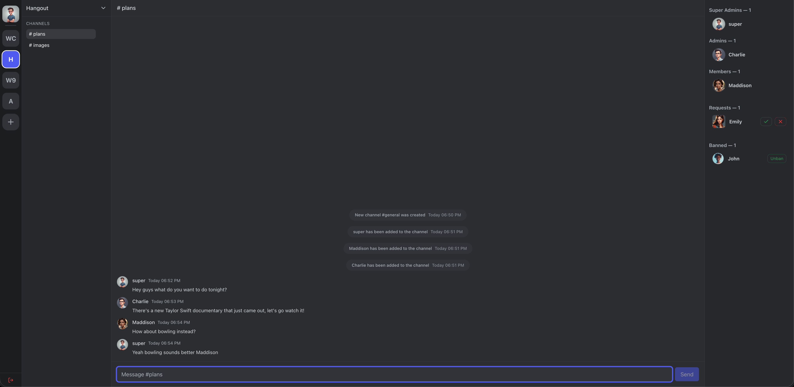

<center> <h1>Chatto.</h1></center>

## About

This repository contains the source code for the web application **Chatto**. Chatto is a web-based real-time chat application where users can connect with each other through groups. When you first register, you can request to join a variety of group chats where you can communicate with other users via text messaging with real-time updates. Group admins can create channels within groups and manage user permissions including banning, kicking, and approving join requests.

Chatto is a Single Page Application (SPA) built on the MEAN stack:

- **MongoDB** - NoSQL database for persistent data storage
- **Express.js** - Node.js web framework for REST API
- **Angular** - Frontend SPA framework with TypeScript
- **Node.js** - JavaScript runtime for the backend server
- **Socket.io** - Real-time bidirectional communication

## Git Repository Organization

### Branch Structure

The repository followed a feature-based branching strategy:

- **`main`** - Production-ready code with stable releases
- **Feature branches** - Individual features developed in isolation before merging

### Repository Structure

```
chatto/
├── src/                    # Angular frontend application
│   ├── app/               # Angular components, services, and models
│   └── ...
├── server/                # Node.js backend application
│   ├── routes/           # API route modules
│   ├── test/             # Backend test suites
│   └── ...
├── screenshots/          # Application screenshots for documentation
└── README.md            # Comprehensive project documentation
```

## Data Structures

### MongoDB Collections

#### `users` Collection

- `id: number` Unique identifier for users
- `username: string` Identifier for user login
- `email: string` The user's email address
- `image?: string` _Optional_ - Image path for avatar
- `birthdate?: Date` _Optional_ - Birth date
- `age?: number | null` _Optional_ - Age
- `roles: string[]` (e.g. `superadmin`, `groupadmin`, `user`)
- `password: string` User set password
- `valid: boolean` Whether the user login is validated
- `banned?: boolean` Flag for when a user has been banned
- `reported?: boolean` Flag when a user has been reported

#### `groups` Collection

- `id: number` Unique identifier for the group
- `name: string` The name of the group
- `description?: string` _Optional_ - Group description
- `owner: number` (user id) - ID of the group owner
- `members: number[]` (user ids) - List of User ID's for group members
- `admins: number[]` (user ids) - List of User ID's who are admins
- `requests?: number[]` (pending join user ids) - List of users ID's requesting to join the group
- `banned?: number[]` (user ids) - List of User ID's banned from the group

#### `channels` Collection

- `id: number` Unique channel identifier
- `name: string` Display name of channel
- `members: number[]` List of user IDs with access to the channel
- `groupId: number` ID of the group the channel belongs to

#### `messages` Collection

- `id: number` Unique message identifier
- `message: string` Message content
- `channelId: number` ID of the channel the message belongs to
- `userId: number` ID of the user who sent the message
- `username: string` Username of the message sender
- `userImage?: string` _Optional_ - Avatar image of the sender
- `dateSent: Date` Timestamp when the message was sent
- `isSystemMessage?: boolean` _Optional_ - Flag for automated system messages
- `systemMessageType?: string` _Optional_ - Type of system message (join, leave, etc.)

### Database Architecture

#### MongoDB Connection (`server/db.js`)

- **Connection Management**: Centralized MongoDB connection using native MongoDB driver
- **Database Operations**: Provides `getDB()`, `connectDB()`, and `health()` functions
- **Collections**: Manages `users`, `groups`, `channels`, and `messages` collections
- **Error Handling**: Robust connection error handling and retry logic

#### CRUD Operations (`server/routes/groups/`)

- **Create** (`create.js`): Handles document insertion with ID generation
- **Read** (`read.js`): Manages data retrieval with filtering and sorting
- **Update** (`update.js`): Processes document updates and modifications
- **Delete** (`delete.js`): Manages document deletion with cascade operations

### Client-side Interfaces

- `src/app/model/user.interface.ts` (`User`)
  - Mirrors server fields used in the client: `id, username, email, image?, birthdate?, age?, roles: string[], password, valid, banned?, reported?`.
- `src/app/model/group.interface.ts` (`Group`)
  - `GroupApi`: server-facing form with ids for relations: `owner: number`, `members: number[]`, `admins: number[]`, optional `channels/requests/banned` as id arrays.
  - `Group`: client-expanded form with resolved relations: `members: User[]`, `admins: User[]`, `channels: Channel[]`.
- `src/app/model/channel.interface.ts` (`Channel`)
  - `id, name, members: number[], groupId` (members reserved for future use; server stores only `groupId`).
- `src/app/model/message.ts` (`Message`)
  - `id, message, channelId, userId, username, userImage?, dateSent, isSystemMessage?, systemMessageType?`

## Angular Architecture

### Components/Pages

- `pages/login` (`Login`): Authentication UI and login flow.
- `pages/signup` (`Signup`): Account creation and validation.
- `pages/profile` (`Profile`): Update user details.
- `pages/admin` (`Admin`): Super admin view for moderation (e.g., bans, reports, role management).
- `pages/dashboard` (`Dashboard`): Main shell containing:
  - `dashboard/group-list` (`GroupList`): Lists groups available to the user and discoverable groups.
  - `dashboard/channel-list` (`ChannelList`): Channels for a selected group; create/delete channel.
  - `dashboard/user-list` (`UserList`): Members/admins/requests for a group; kick/ban/unban/approve/reject.
  - `dashboard/chat` (`Chat`): Real-time messaging interface with Socket.io integration, message history, and live updates.

### Reusable Components (Modals)

- `components/confirm-modal` (`ConfirmModal`): Generic confirm dialog with `confirmed`/`cancelled` outputs. Uses a signal-driven `isOpen` state and closes on backdrop click; inner content stops propagation.
- `components/create-group-modal` (`CreateGroupModal`): Form to create a group. Validates name, calls `Groups.createGroup`, refreshes groups, and manages `isOpen`, `isLoading`, and `error` signals.
- `components/create-user-modal` (`CreateUserModal`): Admin/user creation form with username availability check, template-driven validation, and `UsersService.createUser` integration.
- `components/discover-groups-modal` (`DiscoverGroupsModal`): Lists discoverable groups via `Groups.getDiscoverGroups` and allows request-to-join using a `requested` signal.
- `components/manage-user-modal` (`ManageUserModal`): Placeholder container for future user management actions (ban/unban, role tweaks) following the same modal interaction pattern.

### Services

- `Auth` (`src/app/services/auth.service.ts`)
  - Session utilities via `localStorage`, role checks (`isAuthenticated`, `isSuperAdmin`, `isGroupAdmin`, `hasRole`), and `logout` navigation.
- `UsersService`
  - CRUD and utilities for users: `getUser(s)`, `getAllUsers`, `updateUser`, `deleteUser`, `createUser`, `checkUsername`, `reportUser`.
- `Groups` (`groups.service.ts`)
  - State via Angular signals: `_groups`, `_loading`, `_error`, `_selectedGroupId`.
  - API calls: `getUserGroups`, `loadGroups`, `getDiscoverGroups`, `createGroup`, `updateGroup`, `deleteGroup`, `leaveGroup`.
  - Admin ops: `kickUser`, `banUser`, `unbanUser`, `approveRequest`, `rejectRequest`.
  - Helpers: `selectGroup`, `getSelectedGroup`, `isGroupSelected`, `isGroupAdmin`, `refreshGroups`, `clearSelection`.
- `ChannelsService`
  - Channel state: `channels` and `selectedChannel` signals.
  - API calls: `loadChannels(groupId)`, `createChannel(name, groupId)`, `deleteChannel(channelId)`; selection helpers.
- `SocketService`
  - Real-time communication via Socket.io client integration.
  - Channel management: `joinChannel`, `leaveChannel`, `getCurrentChannelId`.
  - Message operations: `sendMessage`, `deleteMessage`.
  - Event observables: `onMessage`, `onMessageDeleted`, `onUserJoinedChannel`, `onUserLeftChannel`.
  - Group events: `onGroupsUpdated`, `onGroupCreated`, `onGroupDeleted`.
- `MessagesService`
  - HTTP-based message operations: `getMessages(channelId)`, `createMessage`, `deleteMessage`.
  - Integrates with `SocketService` for real-time updates.

### Models

- Interfaces described above under Data Structures are consumed by services and components.

### Guards and Routes

- Guards:
  - `authGuard`: blocks unauthenticated access; redirects to `/login`.
  - `loginGuard`: blocks login/register when authenticated; redirects to `/`.
  - `adminGuard`: restricts `/admin` to super admins.
- Routes (`src/app/app.routes.ts`):
  - `/` → `Dashboard` (authGuard)
  - `/login` → `Login` (loginGuard)
  - `/profile` → `Profile` (authGuard)
  - `/register` → `Signup` (loginGuard)
  - `/admin` → `Admin` (authGuard + adminGuard)
  - `**` → redirect to `/` (Wildcard route catching)

## Node Server Architecture

### Entry point and middleware

- `server/server.js`
  - Express app on port `3000` with `cors` and `express.json()`.
  - MongoDB connection initialization with health checks.
  - Socket.io server initialization for real-time communication.
  - Route modules mounted at `/api/auth`, `/api/groups`, `/api/channels`, `/api/users`, `/api/messages`.
  - Custom response middleware for consistent API responses.

### Real-time Communication (`server/socket.js`)

- **Socket.io Server**: Handles real-time bidirectional communication
- **Channel-based Messaging**: Users join channels for channel-based messaging.
- **Event Handling**:
  - `join-channel` / `leave-channel`: Channel management
  - `new-message`: Real-time message broadcasting to channel members
  - `delete-message`: Live message deletion across all connected members
  - Group management events: `join-group`, `leave-group`, `ban-user`, etc.
- **System Messages**: Automated notifications for user joins, channel creation, etc.
- **Message Persistence**: Integration with MongoDB for chat history storage

### Route Modules (`server/routes/`)

- `auth-route.js`: MongoDB-based authentication with user lookup and ban checking
- `groups-route.js`: Complete MongoDB integration for group CRUD, membership management, and admin operations
- `channels-route.js`: MongoDB-powered channel operations with group validation
- `users-route.js`: Full MongoDB CRUD for user management with role-based permissions
- `messages-route.js`: Message CRUD operations with Socket.io integration for real-time updates

### Database

- `server/db.js`: MongoDB connection management
- `server/routes/groups/`: CRUD operations for consistent database interactions (Only for group management)
  - `create.js`: Document creation with auto-incrementing IDs
  - `read.js`: Data retrieval with filtering and pagination
  - `update.js`: Document updates with validation
  - `delete.js`: Document deletion

## API Reference (Server Routes)

Base URL: `http://localhost:3000/api`

All endpoints use a unified response middleware:

- Success: `200` with JSON body via `res.success(data)`; `201` via `res.created(data)`; `204` via `res.noContent()`
- Errors: `res.fail(status, message, details?)` returns `{ error: string, details?: any }`

### Authentication

| Route    | Method | Parameters                                            | Response                                                                       | Purpose                  |
| -------- | ------ | ----------------------------------------------------- | ------------------------------------------------------------------------------ | ------------------------ |
| `/users` | POST   | `username, email, password, birthdate?, age?, roles?` | `201`: created user (no password)<br>`400`: invalid input<br>`500`: save error | Registers a new user     |
| `/auth`  | POST   | `email (email or username), password`                 | `200`: user with flags or `{ valid: false }`<br>`400`: missing body            | Logs in an existing user |

### Users

| Route                             | Method | Parameters                                            | Response                                                                       | Purpose                                                        |
| --------------------------------- | ------ | ----------------------------------------------------- | ------------------------------------------------------------------------------ | -------------------------------------------------------------- |
| `/users`                          | GET    | `ids?` (CSV query)                                    | `200`: `User[]` (filtered if `ids` provided)                                   | List all users or subset by ids                                |
| `/users/:id`                      | GET    | `id` (path)                                           | `200`: `User`<br>`404`: not found                                              | Get a single user by id                                        |
| `/users/check-username/:username` | GET    | `username` (path)                                     | `200`: `{ exists: boolean }`<br>`400`: empty username                          | Check if a username exists                                     |
| `/users`                          | POST   | `username, email, password, birthdate?, age?, roles?` | `201`: created user (no password)<br>`400`: invalid input<br>`500`: save error | Create a new user                                              |
| `/users/:id`                      | PUT    | `id` (path), partial `User` body                      | `200`: updated `User`<br>`404`: not found                                      | Update user by id                                              |
| `/users/:id/report`               | POST   | `id` (path)                                           | `200`: `{ ok: true }`<br>`404`: not found                                      | Flag a user as reported                                        |
| `/users/:id`                      | DELETE | `id` (path)                                           | `200`: User deleted successfully<br>`404`: not found                           | Delete user; also removes from groups and deletes owned groups |

### Groups

| Route                                       | Method | Parameters                           | Response                                                                                 | Purpose                             |
| ------------------------------------------- | ------ | ------------------------------------ | ---------------------------------------------------------------------------------------- | ----------------------------------- |
| `/groups`                                   | GET    | `userId` (query)                     | `200`: accessible groups<br>`400`: userId required<br>`404`: user not found              | List groups current user can access |
| `/groups/discover`                          | GET    | `userId` (query)                     | `200`: groups user can request to join<br>`400`: missing id                              | Discover joinable groups            |
| `/groups`                                   | POST   | `id` (ownerId), `name`, `image?`     | `201`: created group<br>`400`: invalid name/owner<br>`500`: on error                     | Create a group                      |
| `/groups/:id`                               | PUT    | `id` (path), `name?`, `image?/icon?` | `200`: updated group<br>`400`: invalid name/id<br>`404`: group not found<br>`500`: error | Update a group's details            |
| `/groups/delete/:groupId`                   | DELETE | `groupId` (path)                     | `200`: Group deleted                                                                     | Delete a group                      |
| `/groups/:groupId/users/:userId`            | DELETE | `groupId`, `userId` (path)           | `200`: User removed from group<br>`400`: cannot remove owner<br>`404`: group not found   | Kick/leave user from group          |
| `/groups/:groupId/requests`                 | POST   | `groupId` (path), `userId` (body)    | `201`: `{ ok: true }`<br>`400`: invalid ids<br>`403`: banned<br>`404`: group not found   | Request to join a group             |
| `/groups/:groupId/requests/:userId/approve` | POST   | `groupId`, `userId` (path)           | `200`: `{ ok: true }`<br>`404`: group not found<br>`500`: on error                       | Approve join request                |
| `/groups/:groupId/requests/:userId`         | DELETE | `groupId`, `userId` (path)           | `200`: `{ ok: true }`<br>`404`: group not found<br>`500`: on error                       | Reject join request                 |
| `/groups/:groupId/ban/:userId`              | POST   | `groupId`, `userId` (path)           | `200`: `{ ok: true }`<br>`400`: cannot ban owner<br>`404`: group not found               | Ban user from group                 |
| `/groups/:groupId/ban/:userId`              | DELETE | `groupId`, `userId` (path)           | `200`: `{ ok: true }`<br>`404`: group not found                                          | Unban user from group               |
| `/groups/:userId`                           | DELETE | `userId` (path)                      | `200`: User removed from all groups                                                      | Remove a user from all groups       |

### Channels

| Route           | Method | Parameters                    | Response                                                                                              | Purpose                                            |
| --------------- | ------ | ----------------------------- | ----------------------------------------------------------------------------------------------------- | -------------------------------------------------- |
| `/channels`     | GET    | `groupId` (query)             | `200`: `Channel[]`<br>`400`: groupId required<br>`404`: group not found                               | List channels for a group                          |
| `/channels`     | POST   | `name`, `groupId`             | `201`: created channel<br>`400`: invalid name/id<br>`404`: group not found                            | Create a channel in a group                        |
| `/channels/:id` | DELETE | `id` (path), `userId` (query) | `204`: no content<br>`400`: invalid ids<br>`403`: unauthorized<br>`404`: channel/group/user not found | Delete a channel if user is superadmin/owner/admin |

### Messages

| Route           | Method | Parameters                               | Response                                                                        | Purpose                           |
| --------------- | ------ | ---------------------------------------- | ------------------------------------------------------------------------------- | --------------------------------- |
| `/messages`     | GET    | `channelId` (query), `limit?`, `offset?` | `200`: `Message[]`<br>`400`: channelId required<br>`404`: channel not found     | Get message history for a channel |
| `/messages`     | POST   | `message`, `channelId`, `userId`         | `201`: created message<br>`400`: invalid input<br>`404`: channel/user not found | Send a new message                |
| `/messages/:id` | DELETE | `id` (path), `userId` (query)            | `200`: message deleted<br>`403`: unauthorized<br>`404`: message not found       | Delete a message                  |

## Client–Server Interaction Details

### Authentication and session

- Login makes POST requests to `/api/auth`. On success, the `User` object is stored in `localStorage` under `user`.
- Guards check `Auth.isAuthenticated()` to gate routes; `adminGuard` checks `isSuperAdmin()`.
- Logout clears `localStorage` and navigates to `/login`.

### Groups lifecycle in UI

- On dashboard init, `Groups.loadGroups()` fetches `/api/groups?userId={currentUser.id}` and fills `_groups` signal.
- Selected group id is retrieved from `localStorage`; otherwise first group is selected.
- Group Discover uses `/api/groups/discover?userId={id}`. Request to join posts to `/api/groups/:groupId/requests`.
- Admin actions from `UserList` call respective endpoints (approve/reject/ban/unban/kick). After mutation, the UI calls `Groups.refreshGroups()` or updates local state and re-renders based on signals.

### Channels lifecycle in UI

- When a group is selected, `ChannelsService.loadChannels(groupId)` loads channels via `/api/channels?groupId={groupId}` and sets `channels` signal.
- Creating a channel posts to `/api/channels`; response is appended to `channels` signal.
- Deleting a channel calls DELETE with `userId`; on success, the channel is removed from the signal and the next channel is auto-selected.

### Users lifecycle in UI

- Profile updates make PUT requests to `/api/users/:id`; responses update the profile view.
- Signup makes POST requests to `/api/users`; `Login` then authenticates via `/api/auth`.
- Admin can delete or report users via `UsersService` endpoints; group membership is updated server-side, and the client refreshes groups.

### Real-time Communication

- **Socket.io Integration**: Two-way real-time communication between client and server
- **Channel-based Messaging**: Users automatically join channel-specific rooms for channel-based messages
- **Live Updates**: Messages, user joins/leaves, and group changes update instantly across all members
- **Message History**: Chat history loaded from MongoDB on channel selection, with real-time messages showing
- **System Notifications**: Automated messages for user joins, channel creation, and other events

### UI state and reactivity

- **Angular Signals**: Used for state management (`Groups`, `ChannelsService`, `MessagesService`)
- **Real-time Updates**: Socket.io observables combined with with Angular signals for live UI updates
- **Persistent State**: Selected IDs stored in `localStorage` (`selectedGroupId`, `selectedChannelId`) for session persistence

## Running the Project

### Prerequisites

- **Node.js** (v16 or higher)
- **MongoDB** (local db or MongoDB Atlas connection)
- **Angular CLI** (`npm install -g @angular/cli`)

### MongoDB Setup

1. **Local MongoDB**: Install and start MongoDB service
2. **MongoDB Atlas**: Create cluster and get connection string
3. **Environment**: Update connection string in `server/db.js` if needed

### Express Server

From Project root `/`:

1. `cd server`
2. `npm install`
3. `npm start` or `nodemon server.js`

- **API**: `http://localhost:3000/`

### Angular App

From Project root:

1. `npm install`
2. `ng serve`

- **APP**: `http://localhost:4200/`

### Testing

#### Backend Tests (Mocha + Chai + Supertest)

```bash
cd server
npm test
```

#### Frontend Tests (Angular + Jasmine + Karma)

```bash
npm test
```

## Screenshots

### Chat



### Login


### Signup


### Profile


### Admin Panel


### Discover Groups


### Channel - Group Admin View


### Channel - Super Admin View (1)


### Channel - Super Admin View (2)


### Channel - User View


