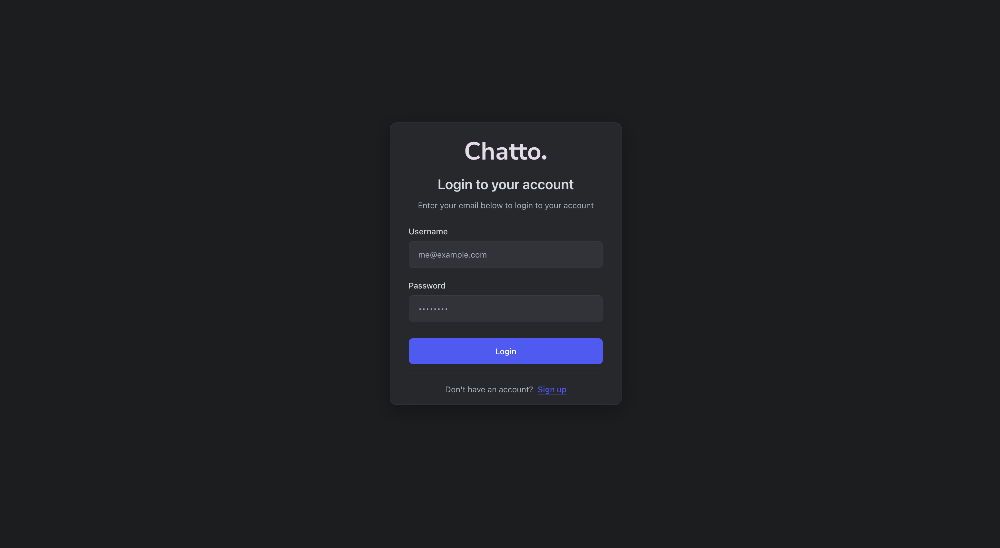
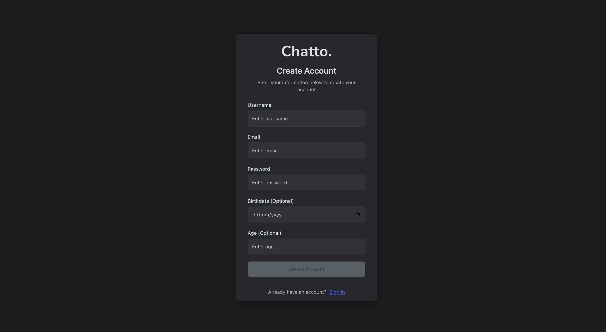
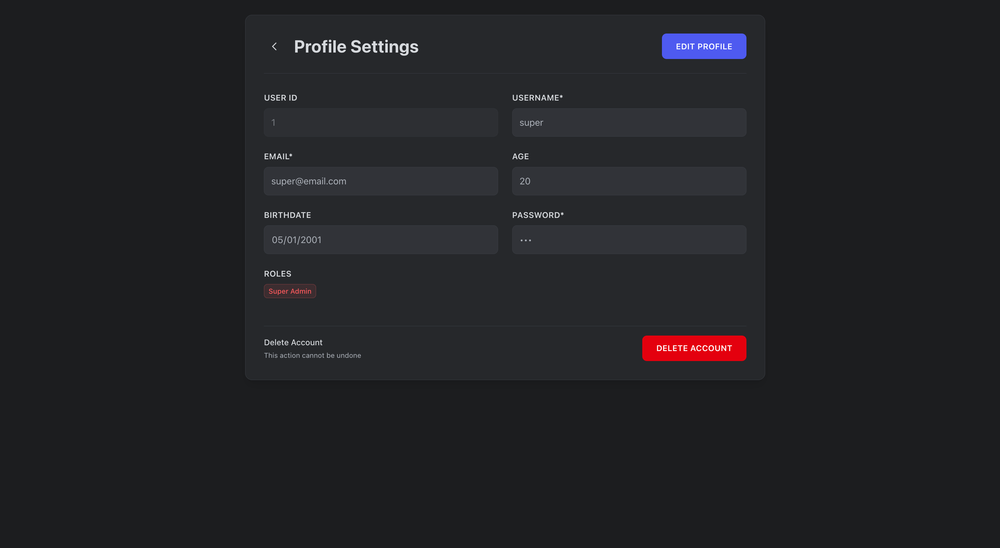
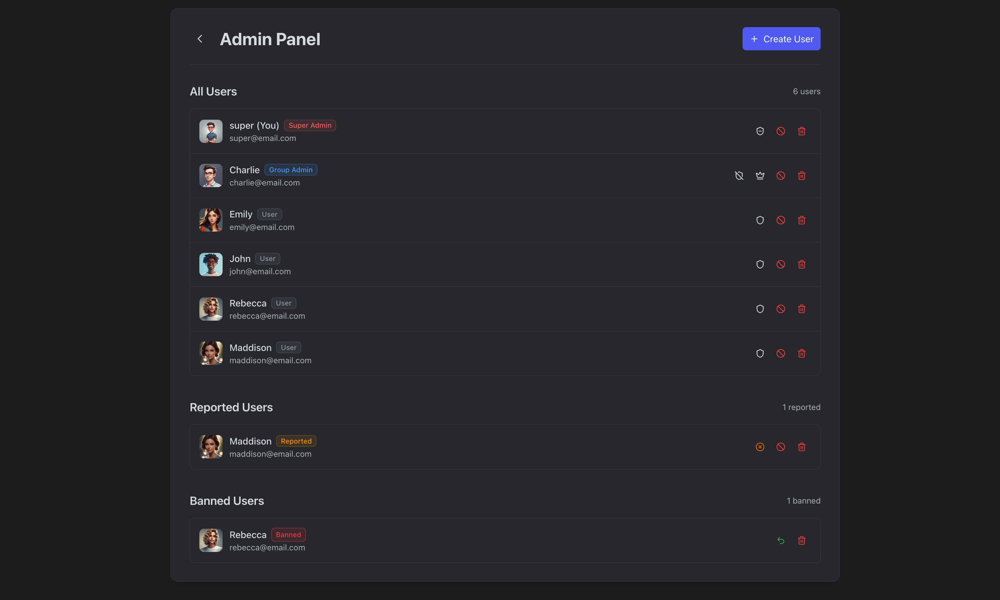
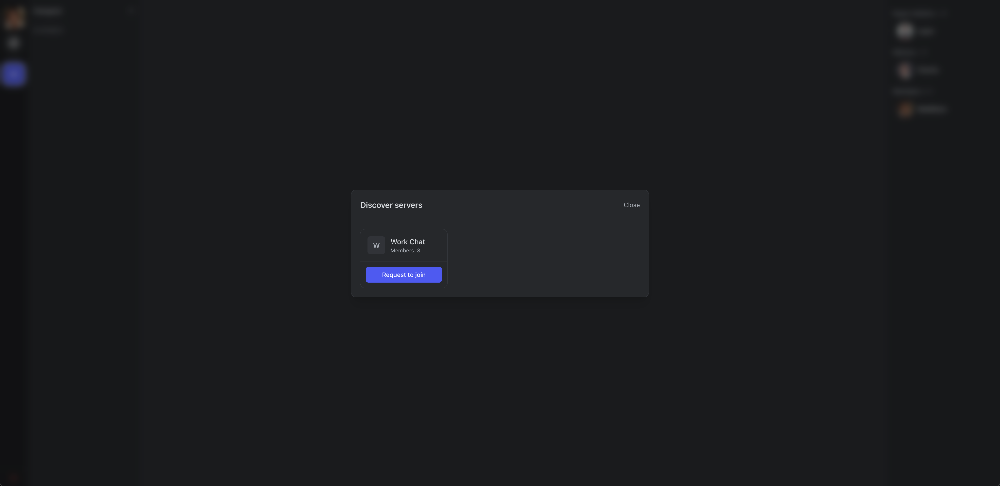
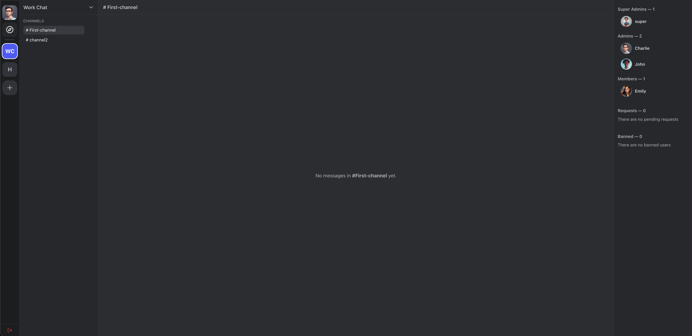
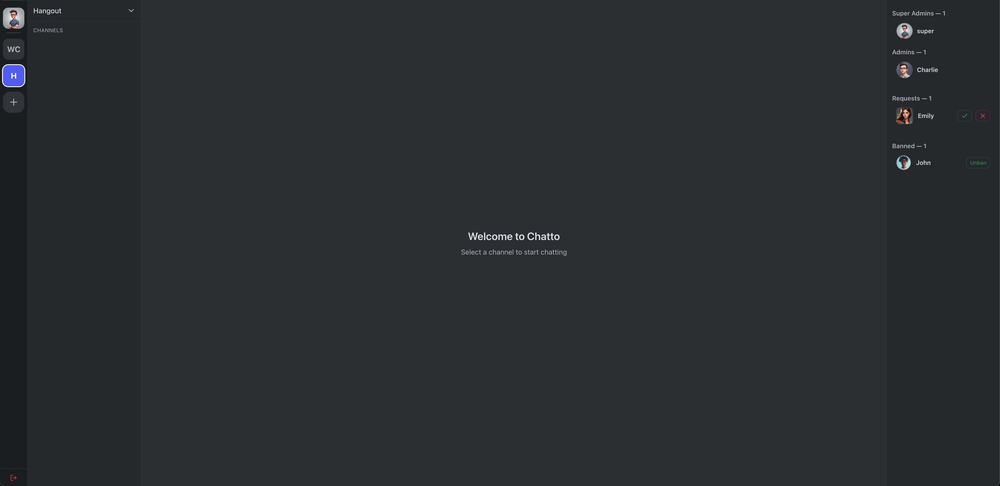
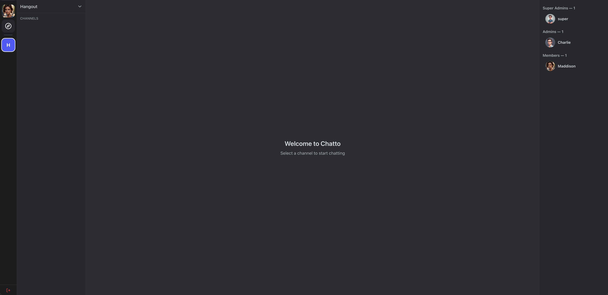

 <h1>Chatto.</h1>

## About

This repository contains the source code for the web application **Chatto**. Chatto is a web based chat and video application where users can connect with eachother through groups. When you first register, you can request to join a variety of group chats where you can communicate with other users via text, voice or chat. At the users request an Admin can create your own personal group where you can invite friends to chat and call to create the next big thing!

Chatto is a SPA based on the MEAN stack using an Node/Express Server backend followed up with an Angular SPA frontend. \*\*Where all data is stored in a NoSQL MongoDB database.

\*\*MongoDB implementation expected in phase 2 of the app

## Data Structures

### Server-side JSON Models

- `users` (server/data/users/users.json)

  - `id: number` Unique identifier for users
  - `username: string` Identifier for user login
  - `email: string` The user's email address
  - `image?: string` _Optional_ - Image path for avatar
  - `birthdate?: string` _Optional_ - Birth date
  - `age?: number | null` _Optional_ - Age
  - `roles: string[]` (e.g. `superadmin`, `groupadmin`, `user`)
  - `password: string` User set password
  - `valid: boolean` Whether the user login is validated
  - `banned: boolean` Flag for when a user has been banned
  - `reported: boolean` Flag when a user has been reported

- `groups` (server/data/groups/groups.json)

  - `id: number` Unique identifier for the group
  - `name: string` The name of the group
  - `icon?: string` _Optional_ - Path for group image
  - `owner: number` (user id) - ID of the group owner
  - `members: number[]` (user ids) - List of User ID's for group members
  - `admins: number[]` (user ids) - List of User ID's who are admins
  - `channels?: number[]` (channel ids) - List of Channels by ID
  - `requests?: number[]` (pending join user ids) - List of users ID's requesting to join the group
  - `banned?: number[]` (user ids) - List of User ID's banned from the group

- `channels` (server/data/channels/channels.json)
  - `id: number` Unique channel identifier
  - `name: string` (separated by hyphen) - Display name of group
  - `groupId: number` ID of the group the channel belongs to

### Server-side constructors

- `server/data/users/user.js` (Users)
  - Provides a constructor used by auth to shape a login response with essential fields and flags.
- `server/data/groups/group.js` (Groups)
  - Minimal constructor (not heavily used by routes) capturing group fields.
- `server/data/channels/channel.js` (Channel)
  - Minimal constructor with `id`, `name`, `groupId`.

### Client-side Interfaces

- `src/app/model/user.interface.ts` (`User`)
  - Mirrors server fields used in the client: `id, username, email, image?, birthdate?, age?, roles: string[], password, valid, banned?, reported?`.
- `src/app/model/group.interface.ts` (`Group`)
  - `GroupApi`: server-facing form with ids for relations: `owner: number`, `members: number[]`, `admins: number[]`, optional `channels/requests/banned` as id arrays.
  - `Group`: client-expanded form with resolved relations: `members: User[]`, `admins: User[]`, `channels: Channel[]`.
- `src/app/model/channel.interface.ts` (`Channel`)
  - `id, name, members: number[], groupId` (members reserved for future use; server stores only `groupId`).

## Angular Architecture

### Components/Pages

- `pages/login` (`Login`): Authentication UI and login flow.
- `pages/signup` (`Signup`): Account creation and validation.
- `pages/profile` (`Profile`): Update user details.
- `pages/admin` (`Admin`): Super admin view for moderation (e.g., bans, reports, role management).
- `pages/dashboard` (`Dashboard`): Main shell containing:
  - `dashboard/group-list` (`GroupList`): Lists groups available to the user and discoverable groups.
  - `dashboard/channel-list` (`ChannelList`): Channels for a selected group; create/delete channel.
  - `dashboard/user-list` (`UserList`): Members/admins/requests for a group; kick/ban/unban/approve/reject.
  - `dashboard/chat` (`Chat`): Channel selection and messaging placeholder.

### Reusable Components (Modals)

- `components/confirm-modal` (`ConfirmModal`): Generic confirm dialog with `confirmed`/`cancelled` outputs. Uses a signal-driven `isOpen` state and closes on backdrop click; inner content stops propagation.
- `components/create-group-modal` (`CreateGroupModal`): Form to create a group. Validates name, calls `Groups.createGroup`, refreshes groups, and manages `isOpen`, `isLoading`, and `error` signals.
- `components/create-user-modal` (`CreateUserModal`): Admin/user creation form with username availability check, template-driven validation, and `UsersService.createUser` integration.
- `components/discover-groups-modal` (`DiscoverGroupsModal`): Lists discoverable groups via `Groups.getDiscoverGroups` and allows request-to-join using a `requested` signal.
- `components/manage-user-modal` (`ManageUserModal`): Placeholder container for future user management actions (ban/unban, role tweaks) following the same modal interaction pattern.

### Services

- `Auth` (`src/app/services/auth.service.ts`)
  - Session utilities via `localStorage`, role checks (`isAuthenticated`, `isSuperAdmin`, `isGroupAdmin`, `hasRole`), and `logout` navigation.
- `UsersService`
  - CRUD and utilities for users: `getUser(s)`, `getAllUsers`, `updateUser`, `deleteUser`, `createUser`, `checkUsername`, `reportUser`.
- `Groups` (`groups.service.ts`)
  - State via Angular signals: `_groups`, `_loading`, `_error`, `_selectedGroupId`.
  - API calls: `getUserGroups`, `loadGroups`, `getDiscoverGroups`, `createGroup`, `updateGroup`, `deleteGroup`, `leaveGroup`.
  - Admin ops: `kickUser`, `banUser`, `unbanUser`, `approveRequest`, `rejectRequest`.
  - Helpers: `selectGroup`, `getSelectedGroup`, `isGroupSelected`, `isGroupAdmin`, `refreshGroups`, `clearSelection`.
- `ChannelsService`
  - Channel state: `channels` and `selectedChannel` signals.
  - API calls: `loadChannels(groupId)`, `createChannel(name, groupId)`, `deleteChannel(channelId)`; selection helpers.

### Models

- Interfaces described above under Data Structures are consumed by services and components.

### Guards and Routes

- Guards:
  - `authGuard`: blocks unauthenticated access; redirects to `/login`.
  - `loginGuard`: blocks login/register when authenticated; redirects to `/`.
  - `adminGuard`: restricts `/admin` to super admins.
- Routes (`src/app/app.routes.ts`):
  - `/` → `Dashboard` (authGuard)
  - `/login` → `Login` (loginGuard)
  - `/profile` → `Profile` (authGuard)
  - `/register` → `Signup` (loginGuard)
  - `/admin` → `Admin` (authGuard + adminGuard)
  - `**` → redirect to `/` (Wildcard route catching)

## Node Server Architecture

### Entry point and middleware

- `server/index.js`
  - Express app on port `3000` with `cors` and `express.json()`.
  - Route modules mounted at `/api/auth`, `/api/groups`, `/api/channels`, `/api/users`.

### Modules and files

- Route modules under `server/routes/`:
  - `auth-route.js`: login endpoint; validates credentials from JSON; returns a `User` response with flags.
  - `groups-route.js`: group listing, discovery, create, membership requests (request/approve/reject), ban/unban, kick/leave, delete.
  - `channels-route.js`: list channels for a group, create channel, delete channel with role checks.
  - `users-route.js`: CRUD for users, username availability, and report.
- Data helpers:
  - `server/read-json.js`: `readJsonAsString`, `writeJsonToFile`, `appendJsonToFile` (JSON file IO with Validation from [Allan Week 3](https://github.com/abrowning-gu/demo-week3/blob/main/week3-server/user-list.js)).
- Persisted data files:
  - `server/data/users/users.json`, `server/data/groups/groups.json`, `server/data/channels/channels.json`.

## API Reference (Server Routes)

Base URL: `http://localhost:3000/api`

All endpoints use a unified response middleware:

- Success: `200` with JSON body via `res.success(data)`; `201` via `res.created(data)`; `204` via `res.noContent()`
- Errors: `res.fail(status, message, details?)` returns `{ error: string, details?: any }`

### Authentication

| Route    | Method | Parameters                                            | Response                                                                       | Purpose                  |
| -------- | ------ | ----------------------------------------------------- | ------------------------------------------------------------------------------ | ------------------------ |
| `/users` | POST   | `username, email, password, birthdate?, age?, roles?` | `201`: created user (no password) `400`: invalid input `500`: save error | Registers a new user     |
| `/auth`  | POST   | `email (email or username), password`                 | `200`: user with flags or `{ valid: false }` `400`: missing body            | Logs in an existing user |

### Users

| Route                             | Method | Parameters                                            | Response                                                                       | Purpose                                                        |
| --------------------------------- | ------ | ----------------------------------------------------- | ------------------------------------------------------------------------------ | -------------------------------------------------------------- |
| `/users`                          | GET    | `ids?` (CSV query)                                    | `200`: `User[]` (filtered if `ids` provided)                                   | List all users or subset by ids                                |
| `/users/:id`                      | GET    | `id` (path)                                           | `200`: `User` `404`: not found                                              | Get a single user by id                                        |
| `/users/check-username/:username` | GET    | `username` (path)                                     | `200`: `{ exists: boolean }` `400`: empty username                          | Check if a username exists                                     |
| `/users`                          | POST   | `username, email, password, birthdate?, age?, roles?` | `201`: created user (no password) `400`: invalid input `500`: save error | Create a new user                                              |
| `/users/:id`                      | PUT    | `id` (path), partial `User` body                      | `200`: updated `User` `404`: not found                                      | Update user by id                                              |
| `/users/:id/report`               | POST   | `id` (path)                                           | `200`: `{ ok: true }` `404`: not found                                      | Flag a user as reported                                        |
| `/users/:id`                      | DELETE | `id` (path)                                           | `200`: User deleted successfully `404`: not found                           | Delete user; also removes from groups and deletes owned groups |

### Groups

| Route                                       | Method | Parameters                           | Response                                                                                 | Purpose                             |
| ------------------------------------------- | ------ | ------------------------------------ | ---------------------------------------------------------------------------------------- | ----------------------------------- |
| `/groups`                                   | GET    | `userId` (query)                     | `200`: accessible groups `400`: userId required `404`: user not found              | List groups current user can access |
| `/groups/discover`                          | GET    | `userId` (query)                     | `200`: groups user can request to join `400`: missing id                              | Discover joinable groups            |
| `/groups`                                   | POST   | `id` (ownerId), `name`, `image?`     | `201`: created group `400`: invalid name/owner `500`: on error                     | Create a group                      |
| `/groups/:id`                               | PUT    | `id` (path), `name?`, `image?/icon?` | `200`: updated group `400`: invalid name/id `404`: group not found `500`: error | Update a group's details            |
| `/groups/delete/:groupId`                   | DELETE | `groupId` (path)                     | `200`: Group deleted                                                                     | Delete a group                      |
| `/groups/:groupId/users/:userId`            | DELETE | `groupId`, `userId` (path)           | `200`: User removed from group `400`: cannot remove owner `404`: group not found   | Kick/leave user from group          |
| `/groups/:groupId/requests`                 | POST   | `groupId` (path), `userId` (body)    | `201`: `{ ok: true }` `400`: invalid ids `403`: banned `404`: group not found   | Request to join a group             |
| `/groups/:groupId/requests/:userId/approve` | POST   | `groupId`, `userId` (path)           | `200`: `{ ok: true }` `404`: group not found `500`: on error                       | Approve join request                |
| `/groups/:groupId/requests/:userId`         | DELETE | `groupId`, `userId` (path)           | `200`: `{ ok: true }` `404`: group not found `500`: on error                       | Reject join request                 |
| `/groups/:groupId/ban/:userId`              | POST   | `groupId`, `userId` (path)           | `200`: `{ ok: true }` `400`: cannot ban owner `404`: group not found               | Ban user from group                 |
| `/groups/:groupId/ban/:userId`              | DELETE | `groupId`, `userId` (path)           | `200`: `{ ok: true }` `404`: group not found                                          | Unban user from group               |
| `/groups/:userId`                           | DELETE | `userId` (path)                      | `200`: User removed from all groups                                                      | Remove a user from all groups       |

### Channels

| Route           | Method | Parameters                    | Response                                                                                              | Purpose                                            |
| --------------- | ------ | ----------------------------- | ----------------------------------------------------------------------------------------------------- | -------------------------------------------------- |
| `/channels`     | GET    | `groupId` (query)             | `200`: `Channel[]` `400`: groupId required `404`: group not found                               | List channels for a group                          |
| `/channels`     | POST   | `name`, `groupId`             | `201`: created channel `400`: invalid name/id `404`: group not found                            | Create a channel in a group                        |
| `/channels/:id` | DELETE | `id` (path), `userId` (query) | `204`: no content `400`: invalid ids `403`: unauthorized `404`: channel/group/user not found | Delete a channel if user is superadmin/owner/admin |

## Client–Server Interaction Details

### Authentication and session

- Login makes POST requests to `/api/auth`. On success, the `User` object is stored in `localStorage` under `user`.
- Guards check `Auth.isAuthenticated()` to gate routes; `adminGuard` checks `isSuperAdmin()`.
- Logout clears `localStorage` and navigates to `/login`.

### Groups lifecycle in UI

- On dashboard init, `Groups.loadGroups()` fetches `/api/groups?userId={currentUser.id}` and fills `_groups` signal.
- Selected group id is retrieved from `localStorage`; otherwise first group is selected.
- Group Discover uses `/api/groups/discover?userId={id}`. Request to join posts to `/api/groups/:groupId/requests`.
- Admin actions from `UserList` call respective endpoints (approve/reject/ban/unban/kick). After mutation, the UI calls `Groups.refreshGroups()` or updates local state and re-renders based on signals.

### Channels lifecycle in UI

- When a group is selected, `ChannelsService.loadChannels(groupId)` loads channels via `/api/channels?groupId={groupId}` and sets `channels` signal.
- Creating a channel posts to `/api/channels`; response is appended to `channels` signal.
- Deleting a channel calls DELETE with `userId`; on success, the channel is removed from the signal and the next channel is auto-selected.

### Users lifecycle in UI

- Profile updates make PUT requests to `/api/users/:id`; responses update the profile view.
- Signup makes POST requests to `/api/users`; `Login` then authenticates via `/api/auth`.
- Admin can delete or report users via `UsersService` endpoints; group membership is updated server-side, and the client refreshes groups.

### UI state and reactivity

- Angular signals are used for local state (`Groups` and `ChannelsService`).
- Selected ids are persisted in `localStorage` (`selectedGroupId`) to preserve selected groups upon reloads (Will reflect the same for channels in phase 2).

## Running the Project

### Express Server

From Project root `/`:

1. `cd server`
2. `npm install`
3. `nodemon` (`index.js` is default server file)

- API: `http://localhost:3000/`

### Angular App

From Project root:

1. `npm install`
2. `ng serve`

- APP: `http://localhost:4200/`

## Disclaimer

- User data is stored under `/server/data/<groups|users|channels>.json` which are temporary solutions required for phase 1 of this app, phase 2 will move to more rubust MongoDB data storage.

## Screenshots

### Login

### Signup

### Profile

### Admin Panel

### Discover Groups

### Channel - Group Admin View

### Channel - Super Admin View (1)

### Channel - Super Admin View (2)

### Channel - User View

